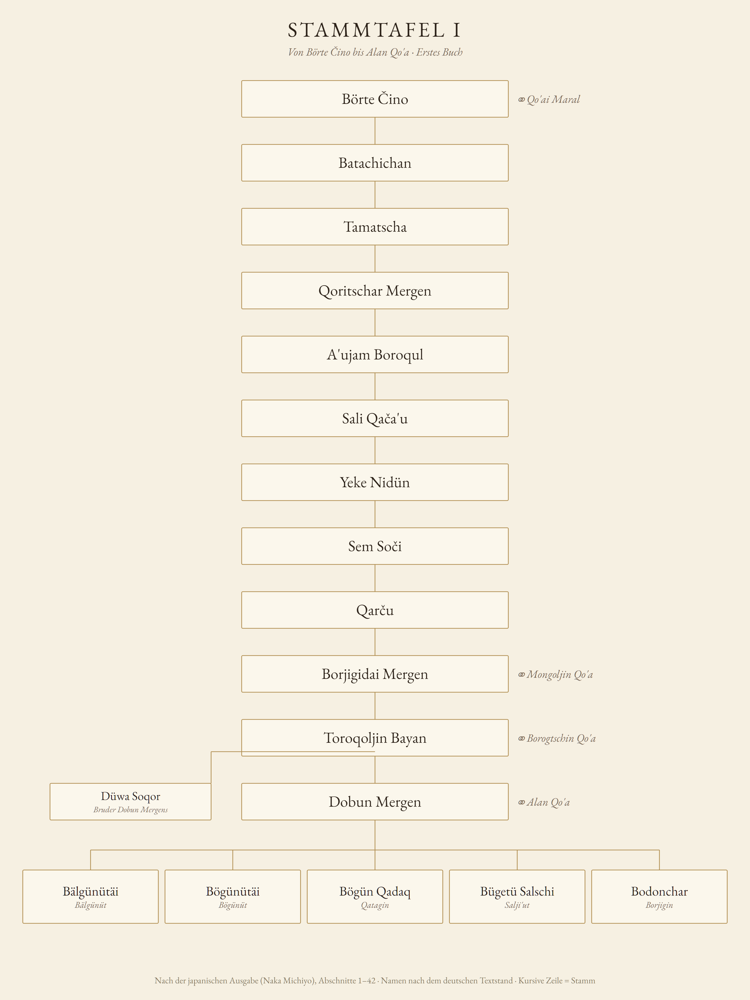
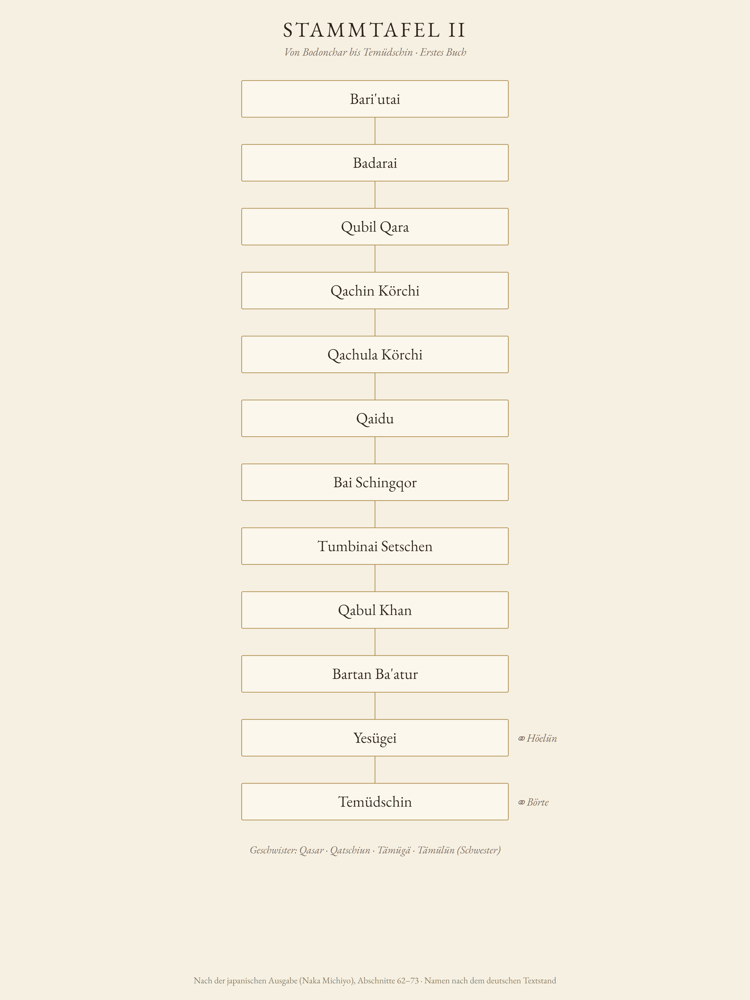
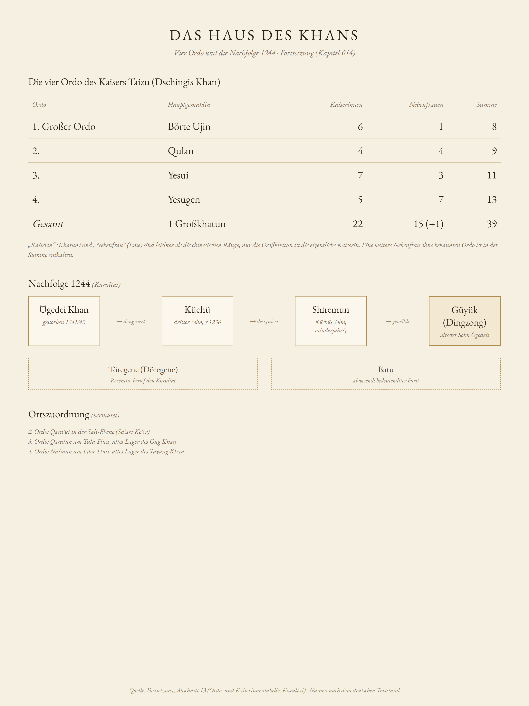

Die drei Tafeln dieses Anhangs fassen die Familienstrukturen des Ersten Buches
und die Ordnung des Hauses in der Fortsetzung zusammen. Grundlage sind die
Abschnitte 1–73 sowie 40–52 der japanischen Ausgabe; die Namen folgen dem
deutschen Textstand.

